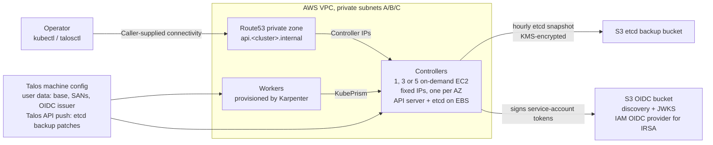
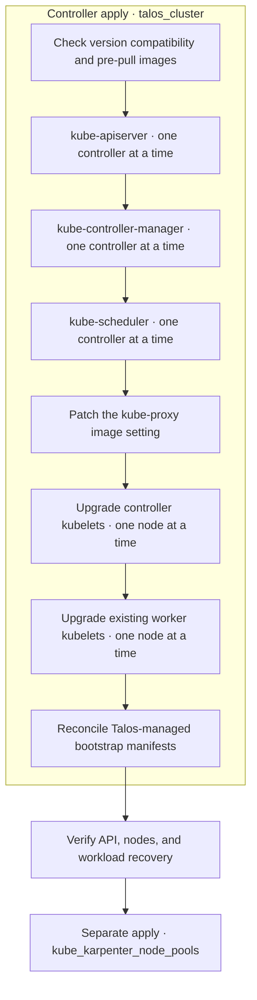

# Talos on AWS

This module runs a Talos Linux Kubernetes cluster on EC2. Controllers and workers sit in private subnets with no public addresses by default. etcd is backed up to S3, and OIDC discovery for service-account tokens is published in a public S3 bucket. The caller supplies the connection to the private Kubernetes and Talos APIs.

## Components



| Component | Purpose |
|---|---|
| Controllers (`aws_instance.control_plane`) | Run the Kubernetes API and etcd. Long-lived, never Spot; resize in place, replace by hand (see "Controller runbook"). |
| Private API name (`aws_route53_record.private_api`) | Stable Kubernetes API name. Its A record lists the controller IPs. |
| Cluster metadata (`node_bootstrap`, `talos_ami_id`) | Karpenter node pools use these outputs to build the Talos worker configuration. |
| Talos config (`talos_machine_configuration`, `_apply`, `_bootstrap`) | User data boots each node; the apply pushes patches too large for the 16 KB user data limit; bootstrap starts etcd once. |
| etcd backups (`backup.tf`) | Hourly KMS-encrypted snapshots to S3, plus a snapshot before any new controller joins. |
| OIDC (`oidc.tf`) | Public discovery documents so AWS IAM trusts service-account tokens (IRSA). |

## Requirements

- An existing VPC with DNS enabled and private subnets tagged `Name = PRIVATE_A`, `PRIVATE_B` and `PRIVATE_C`. The private routes must let the controllers pull images. An SSM host also needs connectivity to AWS Systems Manager.
- A runner that can reach the Talos API on the bootstrap controller on TCP 50000 during apply. Use a runner in the VPC or start a forward from the caller.
- S3 Block Public Access on the account must allow a public bucket policy, and the applying identity must be able to create an IAM OIDC provider.
- The guide's steps 1 and 2 are done: upstream registry credentials are stored and `aws_ecr_pull_through_cache` is deployed.
- `python3`, `aws` CLI v2, `session-manager-plugin`, `terragrunt`, `kubectl`, `kubectx`, `talosctl` and `sops` on `PATH`. The Panfactum devshell provides all of them except `talosctl`.

In the commands below, `<module>` is the path to this module folder in your repository and `<caller>` is the Terragrunt directory that deploys it. Run them from the repository root.

## Select bootstrap connectivity

For homelab operators using the project Headscale client, follow the
[Talos bootstrap guide](../../../../../docs/talos-new-cluster-bootstrap.md#use-the-tailnet-include-after-registration).
It covers the isolated client, the Tailnet include for registered clusters,
and fixed SSM recovery. On a fresh caller, the shared transport lookup can
require a registry entry before OpenTofu runs. Use public bootstrap with the
shared transport enabled, or use the fixed SSM first-apply configuration
without that lookup. Register and merge the VPN endpoints before enabling the
shared VPN transport and Tailnet include.

Use [public bootstrap](../../../../../docs/talos-new-cluster-bootstrap.md#public-bootstrap-before-vpn)
when the operator cannot yet reach the private VPC. Set
`talos_access_transport = "bootstrap_public"` to create a temporary NLB that
allows Talos and Kubernetes traffic from the bootstrap runner's public IPv4.
The module keeps the load balancer and CIDR during the switch to VPN so
OpenTofu can refresh Talos through the previous endpoint. Once a plan succeeds
over VPN, retire the public endpoint with `bootstrap_public = { enabled = false }`.
Use `bootstrap_public.operator_cidr` to supply a different source CIDR before
bootstrapping.

For direct access from a routed runner, set `talos_access_transport = "vpn"`
and provide fixed controller private IPs. The module uses the first
`control_plane` entry. Give the runner's security group Talos
ingress through `talos_api_source_security_groups`.
`kube_api_source_security_groups` grants Kubernetes ingress separately. Both
maps take stable caller-chosen keys and security group IDs as values. Keep
`private_api_dns_name` for the Kubernetes API endpoint. The direct path needs no
Terragrunt session hook.

For a first direct apply, use a runner with the route already established and
caller configuration that does not require a pre-existing registry entry.
The project Tailnet include has been verified against the existing Talos-2
cluster after registration.

For a caller-owned SSM path, apply the [private SSM jump host
module](../aws_ssm_jump_host/README.md) first and wait for its instance to report
`Online`. Pass its security group ID in each relevant ingress map. Include the
module-owned hook and set `talos_access_transport = "ssm"` to use its
`127.0.0.1:50000` Talos listener and include loopback SANs on both APIs. An
explicit `talos_api_endpoint` overrides either transport's derived endpoint.

For SSM, provision the jump hosts and fixed documents in
`aws_ssm_jump_host` before the cluster hook runs. Set
`PF_TALOS_FIXED_SSM` to an absolute JSON path with `cluster`, `account_id`,
`vpc_id` and the jump module's `instance_ids` and `document_destinations`
outputs. Include `controller_ip` for bootstrap or default Talos recovery.
Set `kube_host` only to disambiguate multiple Kubernetes documents.

The Kubernetes context opens only its document. For privileged Talos access,
`cluster_access.py --talos-config --node <controller-ip>` selects the
corresponding document. The helper keeps registered loopback addresses and
verifies TLS. The routed context continues to use private API identities.
Use the explicit `-ssm` context for recovery when routed access is unavailable.
Existing listeners must finish before a new helper can bind the same ports.

## Kubernetes API routing

Talos v1.14.6 generates `KubePrismConfig` for controllers and workers. Keep
the listener at `localhost:7445`. For `kube_cilium`, set
`cluster_type = "talos"` and leave the API host and port overrides unset
so Cilium uses the local listener.

Set `private_api_dns_name` before bootstrapping. The module includes the
hostname in the API certificate and creates a private A record with the
controller IPs. Off-node Kubernetes clients connect to that hostname on
TCP 6443. They need their own connection retries. A fixed-destination SSM
session needs a new connection through a reachable controller after its
destination fails. Keep direct Talos management on TCP 50000 for
configuration and etcd bootstrap.

With three controllers in separate Availability Zones, etcd can keep
quorum after losing one. KubePrism on v1.14.6 can switch peers when TCP
6443 is unreachable. It can still route to a server that accepts TCP
while `/readyz` returns HTTP 500. The private A record lists all controller
IPs regardless of health.

### API load balancer

When `private_api_dns_name` is set, the module puts an internal network load
balancer in front of the controllers. Set `api_load_balancer_enabled = false`
to keep the A record with controller IPs. It listens on
TCP 6443 across the controller subnets and health-checks each controller with
HTTPS `/readyz`, so it stops sending traffic to one that accepts TCP but is
not ready. The private A record becomes an alias to the load balancer. The
Talos API on TCP 50000 stays off it. The target group turns off client IP
preservation so a node can reach itself through the load balancer. The module
adds a load balancer security group and lets it reach the node security
group on 6443. The SSM jump host and `operator_tunnel_security_group_ids` can
reach it. Other clients outside the nodes need their source in
`kube_api_source_security_groups` or `kube_api_allowed_cidrs`. List price is
about $16/month plus LCU charges.

## Bootstrap with fixed SSM

This follows the Panfactum guide [Kubernetes Cluster](https://panfactum.com/docs/edge/guides/bootstrapping/kubernetes-cluster) step for step, starting at step 3. Step numbers match the guide. Each step says "same" or states the Talos difference.

### 3. Deploy the cluster

This module replaces `aws_eks`. It needs Talos-only setup before the apply.

1. Create the secrets bundle. Add a SOPS creation rule for the file, then run:

   ```sh
   python3 <module>/scripts/gen_talos_secrets.py <caller>/talos-secrets.yaml
   ```

   Keep an encrypted copy outside the cluster. Never reuse another cluster's bundle.

2. Include the module's hooks alongside the shared Panfactum configuration in `<caller>/terragrunt.hcl`:

   ```hcl
   include "panfactum" {
     path = find_in_parent_folders("panfactum.hcl")
   }

   include "talos_hooks" {
     path = "${get_repo_root()}/<module>/terragrunt.hooks.hcl"
   }

   terraform {
     source = "${get_repo_root()}/<module>"
   }

   dependency "vpc" {
     config_path = "../aws_vpc"
   }

   dependency "ssm" {
     config_path = "../aws_ssm_jump_host"
   }

   inputs = {
     cluster_name                       = "my-cluster"
     vpc_id                             = dependency.vpc.outputs.vpc_id
     secrets_bundle                     = yamldecode(sops_decrypt_file("${get_terragrunt_dir()}/talos-secrets.yaml"))
     control_plane_public_ip_enabled    = false
     private_api_dns_name               = "api.my-cluster.internal"
     talos_access_transport             = "ssm"
     kube_api_source_security_groups    = { jump = dependency.ssm.outputs.security_group_id }
     talos_api_source_security_groups   = { jump = dependency.ssm.outputs.security_group_id }
     control_plane = [
       { subnet = "PRIVATE_A", private_ip = "10.0.64.10" },
       { subnet = "PRIVATE_B", private_ip = "10.0.128.10" },
       { subnet = "PRIVATE_C", private_ip = "10.0.192.10" },
     ]
   }
   ```

   Point `dependency.vpc.config_path` at the caller that owns the shared VPC.
   Add the standalone jump security group to the Kubernetes and Talos API
   ingress maps. The host needs an outbound path to Systems Manager and to
   the private API destinations in its fixed documents.

   The Talos provider connects through the loopback listener. Cluster nodes need a separate private Kubernetes endpoint. `private_api_dns_name` creates a private hosted zone and an API record for the controllers. Use a unique parent domain per cluster in a shared VPC, such as `api.a.internal` and `api.b.internal`. A single-controller cluster can use a fixed `control_plane` `private_ip` in place of private DNS.

   The include needs a local copy of the hook HCL before Terragrunt downloads the Terraform source. The hook runs the bundled helper from the Terraform working directory in the cache. Terragrunt v0.69.1 exposes `inputs.cluster_name` to the hook as the raw string `TF_VAR_cluster_name`. For the `aws_kube_talos` module, the shared `panfactum.hcl` passes the primary AWS provider's profile, region and expected account via `PF_TALOS_AWS_PROFILE`, `PF_TALOS_AWS_REGION` and `PF_TALOS_AWS_ACCOUNT_ID`. The helper checks the AWS account before looking up controllers.

   The hook calls `cluster_access.py` before `plan`, `apply` and `destroy`.
   It skips SSM on routed access. For first apply, it waits in the background
   for the configured controller while OpenTofu launches it. The helper exits
   with Terragrunt. Check `bootstrap.log` in the tunnel state directory for
   failures.

   When cluster outputs already exist, include `terragrunt.access.hcl` as
   `talos_access` to create the two provider connections with the same helper
   and register the cluster after a successful apply.

3. Set `PF_TALOS_FIXED_SSM` and check the configured SSM path before the
   first plan:

   ```sh
   python3 <module>/scripts/pf-bootstrap-talos preflight --cluster my-cluster --profile <aws-profile> --region <region>
   ```

   The command validates the AWS account, fixed documents and Online jump
   hosts without opening sessions. Review the controller ingress for TCP
   50000 and 6443 and keep the controllers private.

4. Run `pf-tf-init` in the caller. Run the first plan in a new tmux window and
   review it before applying. The Talos provider retries until the forward
   connects.

#### Use cases

Pick a starting size, then scale with the controller runbook. Every case keeps controllers on-demand.

| Use case | Inputs | Result |
|---|---|---|
| Bootstrap (cheapest start, no HA) | one `control_plane` entry, `bootstrap_mode_enabled = true` | 1 controller that also runs workloads, no workers. Losing the controller stops the API until it is replaced or restored from S3. |
| Upscale to HA | 3 (or 5) `control_plane` entries | 1 controller per AZ. etcd survives 1 lost controller (2 with 5). |
| Upscale a controller's size | one entry's `instance_type` larger | In-place stop/start of that controller, about 2 to 2.5 minutes on talos-2. |
| Downscale | `control_plane` entries 5 to 3 to 1, or one `instance_type` smaller | Fewer or smaller controllers. Each removed controller leaves etcd before its instance is destroyed; the plan fails while one is still a member. |

Bootstrap mode. Set `bootstrap_mode_enabled = true` (default `false`) to let a new cluster run its first pods on the controllers before Karpenter launches workers:

1. The flag removes both controller taints even with `control_plane_workloads_enabled = false`. Controllers keep the label `panfactum.com/class=controller`.
2. Without a CNI, nodes carry `node.kubernetes.io/not-ready`. They carry `node.cloudprovider.kubernetes.io/uninitialized` until the AWS cloud controller manager initializes them.
3. To end bootstrap mode, first check that a Karpenter `panfactum.com/class=worker` node can launch. Pods that select that class stay Pending otherwise. On homelab, the 2026-11-20 attempt left pods Pending because that pool hit the on-demand vCPU quota.
4. Once Karpenter launches workers, set `bootstrap_mode_enabled = false`, plan and apply. With `control_plane_workloads_enabled = true`, the `controller=true:NoSchedule` taint returns. With workloads disabled, the default control-plane taint returns.
5. On Talos v1.14.6, the bootstrap mode changes on talos-3 left the boot ID unchanged. See `evidence/talos-bootstrap-mode/roundtrip-summary.md`.

Upscale. To start small and reach HA:

1. Bootstrap with one `control_plane` entry and `private_api_dns_name` set, so the API name already exists.
2. Plan the subnets and addresses of all 3 (or 5) controllers now. Each subnet name may appear only once.
3. Append two entries to `control_plane` and apply, as in "Grow 1 to 3 to 5". The module snapshots etcd to S3 first, then adds the new controllers.
4. To give a controller more CPU or memory, change its entry's `instance_type` and apply, one controller at a time, as in "Resize one controller at a time".

Downscale. To cut cost:

1. Shrink a controller's size first if that is enough: change one entry's `instance_type` to a smaller type of the same CPU architecture and apply.
2. To remove controllers, follow "Shrink 5 to 3 to 1": for each controller that goes, run `talosctl etcd leave` on it and delete its Node, then drop the matching trailing `control_plane` entries and apply.
3. Going from 3 to 1 passes through 2 etcd members, which tolerate no failure. Take a snapshot first (see "Check etcd backups") and do it in one sitting.

The outputs are `cluster_name`, `cluster_url`, `cluster_ca_data` and `cluster_region`, the same as `aws_eks`.

### 4. Connect to the cluster

Run `pf-update-kube-talos` from the Panfactum dev shell to write the Talos contexts into `.kube/config`. The module ships the command at `scripts/pf-update-kube-talos`. It never calls `pf-update-kube`.

Talos clusters use three files in `.kube`:

- `config.talos.yaml` (committed) lists `- module:` paths relative to `environments/`, the same schema as Panfactum's `config.yaml`.
- `config.talos.user.yaml` (gitignored) lists `- name:` and `aws_profile:`, the same schema as `config.user.yaml`. Omitting `transport` selects VPN.
- `cluster_info.talos` (committed) holds the region, API URL, CA and endpoints. `--build` writes it from the module outputs.

The files stay separate from Panfactum's because every `pf-update` runs `pf-update-kube`. That run rewrites the `users` entry of each cluster in `config.user.yaml` to `pf-get-kube-token`, which Talos rejects.

Run `pf-update-kube-talos --build` after `register` adds a cluster and whenever the module outputs change. Then run `pf-update-kube-talos` to write the contexts.

1. After the first successful apply, run `register` as a superuser, the same role as `pf-update-kube --build`:

   ```sh
   python3 <module>/scripts/pf-bootstrap-talos register --cluster my-cluster --module <caller> --region <region> --profile <aws-profile>
   ```

   It appends the module path to `.kube/config.talos.yaml` and the cluster to `.kube/config.talos.user.yaml`. It makes no AWS calls and writes no kubeconfig. Run `pf-update-kube-talos --build` next, then commit `.kube/config.talos.yaml` and `.kube/cluster_info.talos`. The `.kube/.gitignore` must contain `!config.talos.yaml` and `!cluster_info.talos`.

2. Each user, the same role as `config.user.yaml` and `pf-update-kube`. `register` already created or appended `.kube/config.talos.user.yaml`, which stays out of git. Omitting `transport` selects VPN. On a new machine, create that file yourself and list your clusters:

   ```yaml
   clusters:
     - name: my-cluster
       aws_profile: <aws-profile>
   ```

   Then run:

   ```sh
   pf-update-kube-talos
   ```

3. Check access, as in the guide:

   ```sh
   kubectx my-cluster
   kubectl cluster-info
   k9s
   ```

   The Kubernetes credential helper uses the transport selected in `config.talos.user.yaml`. For SSM, the first request opens the tunnel and later requests reuse it.

   The homelab dev shell's `talosctl` follows the Kubernetes context. To use the standard Talos CLI with the context selected by `kubectx`, generate a protected client config and pass it to the CLI:

   ```sh
   talos_config="$(pf-update-kube-talos --talosconfig)"
   talosctl --talosconfig "$talos_config" service etcd
   ```

   Pass a context name after `--talosconfig` to select a different cluster. This operation needs access to the module's sensitive Talos output.

### 5. Reset the cluster

No command is needed, so skip `pf-eks-reset`. The module turns off Flannel, kube-proxy and the Talos CoreDNS in the machine config, so there are no AWS-installed add-ons to remove. Nodes stay `NotReady` until Cilium and CoreDNS are installed. The Panfactum guide "Internal Cluster Networking" installs both, so do that next.

### 6. Configure the Kubernetes provider

Same as the guide. Add the keys to the region's `region.yaml`, with the tunnel's local port:

```yaml
kube_config_context: my-cluster
kube_api_server: https://127.0.0.1:16443
```

This example uses the SSM default port 16443. Modules that run inside the cluster, such as `kube_cilium`, override `kube_api_server` with the in-cluster URL in their `module.yaml`.

### Check etcd backups

After Cilium is running:

```sh
kubectl -n etcd-backup create job --from=cronjob/etcd-backup test-1
```

Confirm that a new `<cluster>-<timestamp>.snap` object appears under `etcd/<cluster>/` in the bucket from the `etcd_backup_bucket` output.

### Differences from the EKS guide

- `pf-update-kube-talos` never calls `pf-update-kube`. It adds contexts from `.kube/cluster_info.talos` and `.kube/config.talos.user.yaml`.
- The API is private. An SSM tunnel reaches it, and the kubeconfig's exec credential plugin (`cluster_access.py --exec-credential`) opens the tunnel on first use.
- Credentials are client certificates, not tokens.

## Controller runbook

Controllers are 1, 3 or 5 on-demand `aws_instance` nodes. Each takes its subnet, optional fixed IP and instance type from its `control_plane` entry and is named `<cluster>-control-plane-<position>`. `api.<cluster>.internal` is an A record with every controller IP. Off-node failover depends on the client's connection retries. Talos and Cilium can use the node-local KubePrism separately. Nothing removes etcd members automatically, so every count change follows the steps below. Check etcd after each step:

```sh
talosctl -n <controller-ip> etcd members
talosctl -n <controller-ip> etcd status
```

### Resize one controller at a time

1. Change one entry's `instance_type`, up or down, for example `t4g.medium` to `t4g.large`.
2. Plan. Expect `aws_instance.control_plane[<i>]` updated in place (`~ instance_type`) and `0 to destroy`. Stop if the plan shows a replace.
3. Apply. The AWS provider stops the instance, changes the type and starts it. The IP, root EBS volume and etcd member stay the same. With one controller the API is down until it boots.
4. Wait until `etcd status` lists every member and the Node is `Ready`, then resize the next controller.

Stay on the same CPU architecture (for example t4g to m7g, both arm64). A type with no shared architecture, such as t4g to t3, makes the AWS provider replace the instance instead of resizing it.

### Grow 1 to 3 to 5

1. Set `private_api_dns_name` if it is unset, and apply.
2. Append entries to `control_plane` until it has 3 (or 5).
3. Apply with `KUBECONFIG` pointing at the operator tunnel. The module first runs the pre-join etcd snapshot, then creates the new controllers. Talos joins each one as a learner and promotes it.
4. Check that `etcd members` lists every controller.
5. Check that each new controller has `spec.providerID` set to `aws:///<az>/<instance-id>`. `kube_aws_ccm` sets the ID for short names and the AWS CCM resolves FQDNs. `control_plane_register_with_fqdn` defaults to `true`. A cluster created with the old default must set it to `false`, because changing it renames existing controller Nodes.

### Shrink 5 to 3 to 1

The module removes the highest positions. The first entry bootstraps the cluster, so it always stays.

1. For each controller that goes, one at a time: run `talosctl -n <its-ip> etcd leave`, then `kubectl delete node <its-node>`. Check `etcd members` before the next one.
2. Remove the same trailing entries from `control_plane` and apply. The plan destroys only the controllers that left.

The plan fails if a controller being removed is still an etcd member, and names its IP. The check runs `talosctl etcd members` against a remaining controller, so `talosctl` must be on PATH and the operator tunnel up. It runs only while a controller above the new count still exists.

### Replace a dead controller

A replacement keeps the fixed IP, so it gets the same hostname, etcd name and Node name.

1. From a healthy controller, run `talosctl -n <healthy-ip> etcd members` and `talosctl -n <healthy-ip> etcd remove-member <dead-member-id>`.
2. Run `kubectl delete node <dead-node>` before the replacement boots. A stale Node keeps the old, immutable `providerID`.
3. Apply with `-replace='aws_instance.control_plane[<i>]'`. The pre-join snapshot runs only if the dead instance is already terminated; otherwise the module still counts it, so take a snapshot first as in "Check etcd backups". The same apply re-pushes that controller's Talos config (OIDC issuer, backup patches), because the `talos_machine` resource is replaced with its instance.
4. The OIDC service-account issuer is in user data, so the new API server signs and accepts the same issuer from first boot. If a controller ever booted with the default issuer (`https://<private_api_dns_name>:6443`), pods that started meanwhile hold tokens every other API server rejects until kubelet refreshes them (about 48 minutes). Find them by decoding the `iss` claim of `/var/run/secrets/kubernetes.io/serviceaccount/token` and restart them; linkerd-cni and cilium agents fail CNI ADD and API calls until then.
5. Check that the replacement Node's `spec.providerID` points to the new EC2 instance. `kube_aws_ccm` sets the ID for short names and the AWS CCM resolves FQDNs.

If Kubernetes recreates a short-name Node on the same EC2 instance with an empty provider ID, plan `kube_aws_ccm` with `-replace='terraform_data.controller_provider_id["<private-ip>"]'` and apply the reviewed plan to assign it again.

### Restore from S3

Use this when etcd has lost quorum. See also "Recovery" below.

1. Copy the newest `etcd/<cluster>/<cluster>-<timestamp>.snap` from the `etcd_backup_bucket` output. Reading it needs `kms:Decrypt` on `etcd_backup_kms_key_arn`.
2. Wipe etcd on every controller: `talosctl -n <ip> reset --system-labels-to-wipe EPHEMERAL --reboot --graceful=false`.
3. On the bootstrap controller, run `talosctl -n <ip> bootstrap --recover-from=./<snapshot>.snap`. The other controllers join it.
4. Check `etcd members`, then run a plan. It must show no change to `talos_cluster.this`.

## Everyday access

- `kubectl`, `kubectx` and `k9s` use the contexts in `.kube/config`. Routed contexts use the private endpoint. An SSM context requires the fixed configuration and opens or reuses a tunnel.
- Run the registration command again when saved cluster access details change.
- Use `talosctl --context <cluster-context> --nodes <controller-ip>` in the repository shell. Outside the wrapper, get a protected path with `cluster_access.py --talos-config` and pass it to Talos.
- A new operator clones the repository, adds their profile to `.kube/config.talos.user.yaml` as in step 4, then runs `pf-update-kube-talos`.
- Run `pf-update-kube-talos` again whenever `.kube/cluster_info.talos` or `.kube/config.talos.user.yaml` changes, or something rewrites `.kube/config`, such as `pf devshell sync`. A plain run makes no AWS calls and only replaces the Talos entries.
- Every AWS profile that can open the tunnel and read the Terraform state gets cluster-admin, because the credential is the admin client certificate. Restrict both with IAM.

## More than one cluster

The bundled hook uses local port 50000. Run Terragrunt operations that use it one at a time, with that port free. `register` takes no port flags, so the SSM tunnel ports cannot be set per cluster.

## Recovery

Never run a full apply to recover a cluster without checking `talos_cluster.this` first. If it is missing from state and the replacement controller has no etcd data, the apply creates an empty etcd. Exclude that resource, restore the snapshot with `talosctl bootstrap --recover-from`, then reconcile.

If the first apply cannot reach Talos, target what the first call needs, then run a full plan and apply: `aws_instance.control_plane`, `aws_security_group.nodes`, `aws_vpc_security_group_ingress_rule.operator_tunnel`, `aws_vpc_security_group_ingress_rule.self`, `aws_vpc_security_group_egress_rule.nodes_all` and `aws_route53_record.private_api`.

## Version upgrades

The Talos provider upgrades Kubernetes through `talos_cluster.this.kubernetes_version`. The apply runner needs access to Talos on TCP 50000 and Kubernetes on TCP 6443 through the same `talos_api_endpoint` host. On a cluster still using the legacy resources, plan the handoff at the running Kubernetes version. Confirm the controller installer matches the running Talos version and schematic. Review the plan for native resource creates and state-only forgets, then verify a clean follow-up plan before changing the version.

For a Kubernetes upgrade, change only `kube_version`, one minor version at a time. Verify that the running Talos version supports it and that a current etcd snapshot exists ([Check etcd backups](#check-etcd-backups)). The plan should update `talos_cluster.this` in place. It can also record updated generated YAML on each `talos_machine` with an unchanged machine configuration hash and installer. The machines ignore Kubernetes image-tag drift so the cluster resource can sequence the rollout. Verify controller components and running worker kubelets after applying. Plan and apply `kube_karpenter_node_pools` separately to generate worker user data with the new Kubernetes version.

For a minor upgrade, set the running CCM image in `kube_aws_ccm` `image_version` before changing `kube_version`. Keep that pin until every API server that CCM can reach runs the target minor. Then plan the tested CCM release for the new minor. See [Stage AWS CCM](../../../../../docs/talos-staged-kubernetes-upgrade.md#stage-aws-ccm-during-a-minor-upgrade).



Talos waits for each static pod to become Ready before moving to the next controller. Each kubelet must report the target version and Ready before Talos moves to the next node. The module disables the kube-proxy DaemonSet, so its image patch does not roll a workload here. [Talos upgrade implementation](https://github.com/siderolabs/talos/blob/v1.14.0/pkg/cluster/kubernetes/talos_managed.go#L130-L168), [kubelet rollout](https://github.com/siderolabs/talos/blob/v1.14.0/pkg/cluster/kubernetes/kubelet.go#L34-L49)

The Talos OS workflow remains separate. Changing `talos_version` replaces `terraform_data.talos_upgrade`, which runs `scripts/version_upgrade.py talos` on one controller at a time and checks etcd and node readiness between controllers. Its installer comes from `installer_image` or the Image Factory schematic for that version. Set `version_upgrades_enabled = false` to skip the serial OS upgrade wrapper. The `talos_machine` resource uses the installer on creation and leaves subsequent OS version changes to the serial wrapper. After an OS upgrade, re-apply the worker pool with the matching `talos_ami_id`.

The module always configures the kubelet ECR credential provider. Boot user data carries the provider config, so kubelet pulls from ECR on first boot. By default the module builds an Image Factory schematic with the `ecr-credential-provider` and `util-linux-tools` extensions and installs it on first boot. One apply gives ECR pulls on first boot, verified on the stock AMI `ami-09c6f2700793a4c46` with Talos v1.14.6. Set `image_factory_schematic_id` or `installer_image` to override it. A custom schematic must include `siderolabs/ecr-credential-provider`. [Sidero Labs Image Factory](https://docs.siderolabs.com/talos/v1.14/learn-more/image-factory), [talos_machine create order](https://github.com/siderolabs/terraform-provider-talos/blob/v0.12.0/pkg/talos/talos_machine_resource.go#L474-L488)

## Configuration notes

- Bootstrap mode: `bootstrap_mode_enabled = true` drops the controller and control-plane taints so controllers run workloads before Karpenter exists. See "Bootstrap mode" for how it ends.
- Networking: Talos never deploys Flannel, kube-proxy or CoreDNS. The controller machine config always deletes the Flannel config and disables kube-proxy and the Talos CoreDNS, because Panfactum `kube_cilium` and `kube_core_dns` deploy networking and DNS. There is no input to change this.
- Talos sets kubelet `cloud-provider=external`, applies `pod_subnets` and `service_subnets`, and outputs `controller_provider_ids` for `kube_aws_ccm`. It does not install AWS CCM; apply `kube_aws_ccm` after `kube_cilium`. Use a worker instance profile in the Karpenter node pools for Cilium ENI IPAM.
- Short-name AWS controllers: the `kube_aws_ccm` apply needs `kubectl` and the operator's kubeconfig. The module matches controller Nodes by EC2 private IP and fills an empty `spec.providerID` on its first apply and when each instance changes. The apply fails if the Node has a different ID. See "Replace a dead controller".
- Controllers: `control_plane` is a list of `{ subnet, private_ip, instance_type }` with 1, 3 or 5 entries; more than 1 needs `private_api_dns_name`. `subnet` is required and must be unique. `private_ip` defaults to null, so AWS assigns one. `instance_type` defaults to `t4g.medium`. The default is one controller in `PRIVATE_A`. State is keyed by list position, so the list is append-only. Growing from 1 to 3 controllers appends two entries; see "Controller runbook". Reordering or removing an entry replaces nodes. The first entry bootstraps `talos_cluster` and serves the kubeconfig.
- Controller class: controllers get the label `panfactum.com/class=controller` and the taint `controller=true:NoSchedule`, the same as `aws_eks`. Only pods that tolerate that taint run there: Panfactum cluster services such as Karpenter, Cilium, CoreDNS, cert-manager, Kyverno and Vault. Karpenter also selects `panfactum.com/class=controller`, so it needs at least one controller in this class. `control_plane_workloads_enabled` defaults to `true`. Setting it to `false` keeps the default Talos control-plane taint and drops the label.
- Karpenter owns the worker role and instance profile. Follow the [worker IAM transfer](../../../../../docs/talos-new-cluster-bootstrap.md#transfer-existing-worker-iam) for an existing cluster.
- Controller identity: `controller_identity.controller_instance_profile_enabled` defaults to `true` and creates and attaches a controller profile, which the kubelet ECR credential provider needs. Set it to `false` to skip the profile. An explicit `controller_instance_profile` takes precedence. Use `controller_identity` to set the IAM name prefix and the exact ECR repositories or cache prefixes.
- Images: the module builds the default Image Factory schematic. Set `image_factory_schematic_id` or `installer_image` to override it, and pass `ami_id` for a custom Talos AMI.
- OIDC: the module creates the `<cluster_name>-oidc-<account_id>` bucket and configures the API server issuer. Planning needs Python 3 and OpenSSL. Rotating the service-account signing key needs a separate procedure that keeps old keys until their tokens expire.
- Public controllers: set `control_plane_public_ip_enabled = true`, choose PUBLIC subnets, and set `talos_api_allowed_cidrs` and `kube_api_allowed_cidrs`. Set `talos_api_endpoint = null` to reach Talos through the Elastic IP.
- Secrets: older callers can keep passing `machine_secrets` and `client_configuration`. New callers pass `secrets_bundle`. Secrets still end up in Terraform state and EC2 user data, so restrict access to both.
