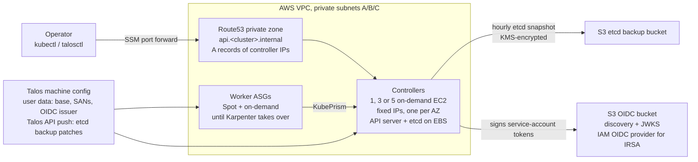

# Talos on AWS

This module runs a Talos Linux Kubernetes cluster on EC2. Controllers and workers sit in private subnets with no public addresses. etcd is backed up to S3, and OIDC discovery for service-account tokens is published in a public S3 bucket. Operators reach the Kubernetes and Talos APIs through an AWS SSM port forward, so no API is exposed to the internet by default.

## Components



| Component | Purpose |
|---|---|
| Controllers (`aws_instance.control_plane`) | Run the Kubernetes API and etcd. Long-lived, never Spot; resize in place, replace by hand (see "Controller runbook"). |
| Private API name (`aws_route53_record.private_api`) | One stable name for the API; clients try each controller IP. |
| Worker ASGs (`aws_autoscaling_group.worker`, `worker_on_demand`) | Bootstrap capacity for the first pods, since controllers carry the `controller=true:NoSchedule` taint. |
| Talos config (`talos_machine_configuration`, `_apply`, `_bootstrap`) | User data boots each node; the apply pushes patches too large for the 16 KB user data limit; bootstrap starts etcd once. |
| etcd backups (`backup.tf`) | Hourly KMS-encrypted snapshots to S3, plus a snapshot before any new controller joins. |
| OIDC (`oidc.tf`) | Public discovery documents so AWS IAM trusts service-account tokens (IRSA). |

## Caller-owned bootstrap transport

A routed caller sets `talos_access_transport = "vpn"` to use the configured
bootstrap controller's fixed private IP. Use `talos_api_endpoint` to override
that address. Set `kube_api_source_security_groups` and
`talos_api_source_security_groups` independently. Use stable map keys and
supply security group IDs as their values.

For SSM, configure the fixed-destination documents in
[`aws_ssm_jump_host`](../aws_ssm_jump_host/README.md) with `talos_bootstrap` using the planned
private API hostname and fixed controller IPs. Deploy the jump host and its
documents first and wait until the instance is SSM Online.
Pass the jump host security group to both ingress maps and set
`talos_access_transport = "ssm"` to select the local Talos forward on port
50000 and include loopback in both API certificates. The maps also accept the security group of an explicitly selected
emergency NAT.

Run `scripts/operator_tunnel.py bootstrap` directly as a caller Terragrunt
before hook with the cluster name, AWS profile, account, region, VPC, private
controller IP, jump host ID and local Talos port. The hook can wait for a
controller created by the same apply. Run `operator_tunnel.py --help` for
the full arguments. Use `operator` for the Kubernetes-only forward and
`recovery --nat-host <instance-id>` for both API forwards through the NAT.
Each session uses a document with a fixed remote destination. AWS IAM
determines which principals can use each target and document.

## Public bootstrap

Set `talos_access_transport = "bootstrap_public"`. The module creates the
temporary NLB and allows the bootstrap runner's public IPv4 as a `/32`.
Set `private_api_dns_name` and keep the controllers in
private subnets. The module needs one Panfactum-tagged public subnet in the
bootstrap controller's availability zone. Leave `talos_api_endpoint` empty
and omit any caller SSM hook for the first apply.

The NLB forwards TCP to the private bootstrap controller. Each API verifies
its own client certificate. The outputs `bootstrap_public_talos_endpoint`,
`bootstrap_public_kube_url` and `bootstrap_public_node` identify the public
addresses and private Talos target. Use the generated `talosconfig` and
`kubeconfig` credentials. For Kubernetes, override the server with the
public URL while keeping its CA and client credentials.

Configure and verify VPN access before switching `talos_access_transport`
to `vpn`. The module retains the NLB and its CIDR during the switch. If
controller IPs were dynamically assigned, set `talos_api_endpoint` to the
discovered private IP when switching. After a plan succeeds over VPN, set
`bootstrap_public = { enabled = false }` and review the removal plan. Set
`bootstrap_public.operator_cidr` before bootstrap if the Talos client uses
a different source CIDR.

## Kubernetes API routing

Talos v1.14.6 generates `KubePrismConfig` for controllers and workers. Keep
the listener at `localhost:7445`. For `kube_cilium`, set
`cluster_type = "talos"` and leave the API host and port overrides unset
so Cilium uses the local listener.

Set `private_api_dns_name` before bootstrapping. The module includes the
hostname in the API certificate and creates a private A record with the
controller IPs. Off-node Kubernetes clients connect to that hostname on
TCP 6443. They need their own connection retries. A fixed-destination SSM
session needs a new connection through a reachable controller after its
destination fails. Keep direct Talos management on TCP 50000 for
configuration and etcd bootstrap.

With three controllers in separate Availability Zones, etcd can keep
quorum after losing one. KubePrism on v1.14.6 can switch peers when TCP
6443 is unreachable. It can still route to a server that accepts TCP
while `/readyz` returns HTTP 500. The private A record lists all controller
IPs regardless of health.

## Requirements

- A VPC with subnets tagged `Name = PRIVATE_A`, `PRIVATE_B` and `PRIVATE_C` that route `0.0.0.0/0` through NAT. Nodes pull images and join the cluster through that route.
- An SSM tunnel host in the same VPC that shows `Online`. Either let the module create one (`ssm_jump_host_enabled = true`, see "SSM jump host") or use an existing EC2 host registered with SSM, such as a NAT instance or bastion. Your AWS identity needs `ssm:StartSession` on it.
- S3 Block Public Access on the account must allow a public bucket policy, and the applying identity must be able to create an IAM OIDC provider.
- `python3`, `aws` CLI v2, `session-manager-plugin`, `terragrunt`, `kubectl`, `kubectx`, `talosctl` and `sops` on `PATH`. The Panfactum devshell provides all of them except `talosctl`.

In the commands below, `<module>` is the path to this module folder in your repository and `<caller>` is the Terragrunt directory that deploys it. Run them from the repository root.

## Bootstrap a new cluster

This follows the Panfactum guide [Kubernetes Cluster](https://panfactum.com/docs/edge/guides/bootstrapping/kubernetes-cluster) step for step. Each step says "same" or states the Talos difference.

### 1. Get upstream registry credentials

Same as the guide.

### 2. Deploy the ECR pull-through cache

Same as the guide: deploy `aws_ecr_pull_through_cache`.

### 3. Deploy the cluster

This module replaces `aws_eks`. It needs Talos-only setup before the apply.

1. Create the secrets bundle. Add a SOPS creation rule for the file, then run:

   ```sh
   python3 <module>/scripts/gen_talos_secrets.py <caller>/talos-secrets.yaml
   ```

   Keep an encrypted copy outside the cluster. Never reuse another cluster's bundle.

2. Write `<caller>/terragrunt.hcl`:

   ```hcl
   terraform {
     source = "${get_repo_root()}//<module>"

     before_hook "talos_tunnel" {
       commands = ["plan", "apply", "destroy"]
       execute  = ["python3", "${get_repo_root()}/<module>/scripts/cluster_access.py", "--bootstrap", "--background",
                   "--cluster", "my-cluster", "--profile", "<aws-profile>", "--region", "<region>"]
     }
     after_hook "talos_register" {
       commands     = ["apply"]
       execute      = ["python3", "${get_repo_root()}/<module>/scripts/pf-bootstrap-talos", "register",
                       "--cluster", "my-cluster", "--module", get_terragrunt_dir(),
                       "--region", "<region>", "--profile", "<aws-profile>"]
       run_on_error = false
     }
   }

   dependency "vpc" {
     config_path = "../aws_vpc"
   }

   inputs = {
     cluster_name                       = "my-cluster"
     vpc_id                             = dependency.vpc.outputs.vpc_id
     secrets_bundle                     = yamldecode(sops_decrypt_file("${get_terragrunt_dir()}/talos-secrets.yaml"))
     private_api_dns_name               = "api.my-cluster.internal"
     ssm_jump_host_enabled              = true
     control_plane_count                = 3
     control_plane_subnets              = ["PRIVATE_A", "PRIVATE_B", "PRIVATE_C"]
     control_plane_private_ips          = ["10.0.64.10", "10.0.128.10", "10.0.192.10"]
   }
   ```

   `ssm_jump_host_enabled = true` creates the module's SSM jump host and opens ports 6443 and 50000 on the nodes to it. Set `operator_tunnel_security_group_ids = ["sg-0123456789abcdef0"]` as well only when you also tunnel through existing hosts, such as NAT instances. Pass the security groups of those hosts. If you leave `ssm_jump_host_enabled` at `false`, set `operator_tunnel_security_group_ids`, or no host can reach the APIs.

   `private_api_dns_name` creates a private hosted zone for its parent domain. Clusters in the same VPC need different parent domains, such as `api.a.internal` and `api.b.internal`.

   The `before_hook` forwards the Talos port to `my-cluster-control-plane-0`, so the first apply runs in one terminal. The jump host does not exist before the first apply. In `--bootstrap` mode the hook waits within `--wait` for a host to come `Online`, so it picks up the jump host once it registers with SSM. `--background` returns within a few seconds, leaves a helper that holds the forward, and closes it when Terragrunt exits. It waits up to 15 minutes for the controller to launch and reuses a live `--ensure` tunnel on the same port. Its log is `bootstrap.log` in the tunnel state directory. The `after_hook` runs step 4's `register` after every successful apply.

3. Check your setup:

   ```sh
   python3 <module>/scripts/pf-bootstrap-talos preflight --cluster my-cluster --profile <aws-profile> --region <region>
   ```

   Fix every `FAIL` line before you continue. The preflight finds existing SSM hosts by `Name = nat-*`. Pass `--tunnel-name-pattern` if yours is named differently. It skips the host check before the first apply, because the controller does not exist yet and the module's jump host does not either.

4. Run `pf-tf-init` and `terragrunt apply` in `<caller>`. The module launches the controllers and bootstraps etcd. Use Karpenter to launch workers. The Talos provider keeps retrying until the forward connects.

#### AWS cloud controller manager

Talos installs the AWS cloud controller manager (CCM) during bootstrap. Kubernetes `1.36` defaults to CCM `v1.36.1`. Set `aws_ccm.image_version` to override the default or to select an image for a different Kubernetes minor. Use the Kubernetes major and the target or preceding minor. See [CCM adoption](CCM-ADOPTION.md) before you apply to a cluster with a standalone release.

For SSM, add `--bootstrap-kubernetes` to the `before_hook` above. Set
`--control-plane-name` to the bootstrap controller if it is not position
zero. Keep the hook on `plan`, `apply` and `destroy`. If you use
`scripts/operator_tunnel.py bootstrap` with fixed SSM documents, pass the
same flag and use the bootstrap controller's private IP for its forwarding
documents. Both scripts have separate local Talos and Kubernetes ports.
If you change `--kube-port`, match it with `aws_ccm.operator_kube_port`.

Use `terragrunt plan` and `terragrunt apply` on the Talos unit. Both providers
use the authenticated operator API endpoint. For SSM the helper forwards to
the controller's private IP while the providers verify the API certificate
name. The bootstrap helper exits with Terragrunt. On failure, inspect
`bootstrap.log` and rerun the Talos unit. OpenTofu records completed resources,
including the Helm release. A successful apply checks a CCM leader, the
bootstrap controller's AWS provider ID, and removal of its cloud initialization
taint. Run Cilium after the Talos apply succeeds. Keep the API available through
CCM removal.

Include this module's `terragrunt.providers.hcl` when your caller inherits
the shared provider templates. OpenTofu adds Helm to the lockfile during
init and the shared template can generate Helm 2-style `helm.tf` on later
runs. The include updates the generated
file for Helm 3. Use the same module revision for the source and this include.

See [adopting an existing CCM release](CCM-ADOPTION.md) before enabling the
input on a cluster whose CCM already has standalone state.

#### SSM jump host

Set `ssm_jump_host_enabled = true` to let the module create the tunnel host, so the VPC needs no SSM-managed NAT instance or bastion. The default is `false`.

| Input | Default | Meaning |
|---|---|---|
| `ssm_jump_host_enabled` | `false` | Creates the host and its node ingress rules. |
| `ssm_jump_host_instance_type` | `t4g.nano` | Instance type. It must support arm64. |
| `ssm_jump_host_subnet` | first `control_plane_subnets` entry | `Name` tag of the private subnet to launch in. |

The host is named `<cluster_name>-ssm-tunnel`, runs Amazon Linux 2023 on arm64, has no public IP, requires IMDSv2 and has an encrypted gp3 root volume. Its IAM role has `AmazonSSMManagedInstanceCore`. Its security group has egress only and no ingress, so SSM sessions go outbound through the subnet's NAT route. The nodes allow ports 6443 and 50000 from that security group.

The module reads the AMI from the SSM parameter `/aws/service/ami-amazon-linux-latest/al2023-ami-kernel-default-arm64`, so the applying role needs `ssm:GetParameter` on it. The module ignores later AMI changes, so a new AMI does not replace a host that has an open session. The outputs are `ssm_jump_host_instance_id` and `ssm_jump_host_security_group_id`.

`cluster_access.py` looks for hosts named `<cluster>-ssm-tunnel` or matching `--tunnel-name-pattern`, and tries the jump host first. With `--bootstrap` it waits within `--wait` (default 900 seconds) for a host to become `Online`. Without `--bootstrap` it fails at once when no host is `Online`.

Cost, estimated on 2026-11-20 from public us-east-2 list prices (the AWS CLI was not available to query them live), at 730 hours per month:

| Item | Estimate |
|---|---|
| `t4g.nano` on-demand, about $0.0042 per hour | about $3.07 per month |
| gp3 root volume, 8 GiB at about $0.08 per GB-month (the AL2023 AMI default size) | about $0.64 per month |
| Total | about $3.71 per month |

The host has no public IPv4 address, so there is no address charge. Larger instance types cost more.

#### Use cases

Pick a starting size, then scale with the controller runbook. Every case keeps controllers on-demand.

| Use case | Inputs | Result |
|---|---|---|
| Bootstrap (cheapest start, no HA) | `control_plane_count = 1`, `worker_count = 1` | 1 controller, 1 worker. Losing the controller stops the API until it is replaced or restored from S3. |
| Upscale to HA | `control_plane_count = 3` (or 5) | 1 controller per AZ. etcd survives 1 lost controller (2 with 5). |
| Upscale a controller's size | one `control_plane_instance_types` entry larger | In-place stop/start of that controller, about 2 to 2.5 minutes. |
| Downscale | `control_plane_count` 5 to 3 to 1, or one type smaller | Fewer or smaller controllers. Each removed controller leaves etcd before its instance is destroyed; the plan fails while one is still a member. |

Bootstrap mode. There is no `bootstrap_mode_enabled` input. A new cluster is in bootstrap mode while it runs only what this module creates:

1. Controllers carry the `controller=true:NoSchedule` taint from the first boot. Pods that do not tolerate it, such as the guide's test pods, run on the module's worker Auto Scaling groups (`worker_count`, default 1).
2. Panfactum services that tolerate the taint, such as Cilium, CoreDNS and Karpenter, can run on controllers.
3. Bootstrap mode ends when Karpenter's node pools launch workers. Then lower `worker_count` (or remove the worker groups) and let Karpenter run the rest.

Upscale. To start small and reach HA:

1. Bootstrap with `control_plane_count = 1` and `private_api_dns_name` set, so the API name already exists.
2. List all 3 (or 5) subnets in `control_plane_subnets` from the start; the module uses only the first `control_plane_count`. `control_plane_private_ips` must have exactly `control_plane_count` entries, so plan the addresses now and add them when you raise the count.
3. Set `control_plane_count = 3`, append the new addresses to `control_plane_private_ips` and apply, as in "Grow 1 to 3 to 5". The module snapshots etcd to S3 first, then adds the new controllers.
4. To give a controller more CPU or memory, change its `control_plane_instance_types` entry and apply, one controller at a time, as in "Resize one controller at a time".

Downscale. To cut cost:

1. Shrink a controller's size first if that is enough: change one `control_plane_instance_types` entry to a smaller type of the same CPU architecture and apply.
2. To remove controllers, follow "Shrink 5 to 3 to 1": for each controller that goes, run `talosctl etcd leave` on it and delete its Node, then lower `control_plane_count`, drop the matching trailing entries from `control_plane_private_ips` and apply.
3. Going from 3 to 1 passes through 2 etcd members, which tolerate no failure. Take a snapshot first (see "Check etcd backups") and do it in one sitting.

The outputs are `cluster_name`, `cluster_url`, `cluster_ca_data` and `cluster_region`, the same as `aws_eks`.

### 4. Connect to the cluster

Talos uses `pf-bootstrap-talos` in place of `pf-update-kube`, and `.kube/config.talos.yaml` and `.kube/config.talos.user.yaml` in place of `.kube/config.yaml` and `.kube/config.user.yaml`.

1. Superuser, the same role as `pf-update-kube --build`. The `after_hook` from step 3 already ran `register`. To run it by hand:

   ```sh
   python3 <module>/scripts/pf-bootstrap-talos register --cluster my-cluster --module <caller> --region <region> --profile <aws-profile>
   ```

   It writes `.kube/config.talos.yaml`, which holds the region, ports, module path and CA with no secrets, and merges the cluster into `.kube/config`. It also adds the cluster to `.kube/config.talos.user.yaml`. Commit `.kube/config.talos.yaml`. The `.kube/.gitignore` must contain `!config.talos.yaml`.

2. Each user, the same role as `config.user.yaml` and `pf-update-kube`. `register` already created or appended `.kube/config.talos.user.yaml`, which stays out of git. On a new machine, create that file yourself and list your clusters:

   ```yaml
   clusters:
     - name: my-cluster
       aws_profile: <aws-profile>
   ```

   Then run:

   ```sh
   python3 <module>/scripts/pf-bootstrap-talos merge
   ```

3. Check access, as in the guide:

   ```sh
   kubectx my-cluster
   kubectl cluster-info
   k9s
   ```

   `kubectx` only switches the context. The first `kubectl` request runs the credential helper, which opens the SSM tunnel and takes about 30 seconds. Later requests reuse it.

### 5. Reset the cluster

No command is needed, so skip `pf-eks-reset`. The module turns off Flannel, kube-proxy and the Talos CoreDNS in the machine config, so there are no AWS-installed add-ons to remove. Nodes stay `NotReady` until Cilium and CoreDNS are installed. The Panfactum guide "Internal Cluster Networking" installs both, so do that next.

### 6. Configure the Kubernetes provider

Same as the guide. Add the keys to the region's `region.yaml`, with the tunnel's local port:

```yaml
kube_config_context: my-cluster
kube_api_server: https://127.0.0.1:16443
```

Use the `--kube-port` value for the port if you changed it. Modules that run inside the cluster, such as `kube_cilium`, override `kube_api_server` with the in-cluster URL in their `module.yaml`.

### Check etcd backups

After Cilium is running:

```sh
kubectl -n etcd-backup create job --from=cronjob/etcd-backup test-1
```

Confirm that a new `<cluster>-<timestamp>.snap` object appears under `etcd/<cluster>/` in the bucket from the `etcd_backup_bucket` output.

### Differences from the EKS guide

- No `pf-update-kube`, because it hardcodes the EKS `pf-get-kube-token` credential. Talos uses its own two files and `pf-bootstrap-talos merge`.
- The API is private. An SSM tunnel reaches it, and the kubeconfig's exec credential plugin (`cluster_access.py --exec-credential`) opens the tunnel on first use.
- Credentials are client certificates, not tokens.

## Controller runbook

Controllers are 1, 3 or 5 on-demand `aws_instance` nodes. Each has a fixed IP from `control_plane_private_ips` and is named `<cluster>-control-plane-<position>`. `api.<cluster>.internal` is an A record with every controller IP. Clients try each address, and KubePrism load-balances inside the cluster. Nothing removes etcd members automatically, so every count change follows the steps below. Check etcd after each step:

```sh
talosctl -n <controller-ip> etcd members
talosctl -n <controller-ip> etcd status
```

### Resize one controller at a time

1. Change one entry of `control_plane_instance_types`, up or down, for example `t4g.medium` to `t4g.large`.
2. Plan. Expect `aws_instance.control_plane[<i>]` updated in place (`~ instance_type`) and `0 to destroy`. Stop if the plan shows a replace.
3. Apply. The AWS provider stops the instance, changes the type and starts it. The IP, root EBS volume and etcd member stay the same. With one controller the API is down until it boots.
4. Wait until `etcd status` lists every member and the Node is `Ready`, then resize the next controller.

Stay on the same CPU architecture (for example t4g to m7g, both arm64). A type with no shared architecture, such as t4g to t3, makes the AWS provider replace the instance instead of resizing it.

### Grow 1 to 3 to 5

1. Set `private_api_dns_name` if it is unset, and apply.
2. Append subnets to `control_plane_subnets` and addresses to `control_plane_private_ips`, then set `control_plane_count` to 3 (or 5).
3. Apply with `KUBECONFIG` pointing at the operator tunnel. The module first runs the pre-join etcd snapshot, then creates the new controllers. Talos joins each one as a learner and promotes it.
4. Check that `etcd members` lists every controller.

### Shrink 5 to 3 to 1

The module removes the highest positions. Keep `bootstrap_control_plane` among the controllers that stay.

1. For each controller that goes, one at a time: run `talosctl -n <its-ip> etcd leave`, then `kubectl delete node <its-node>`. Check `etcd members` before the next one.
2. Set `control_plane_count` to the new value, remove the same trailing entries from `control_plane_private_ips`, and apply. The plan destroys only the controllers that left.

The plan fails if a controller being removed is still an etcd member, and names its IP. The check runs `talosctl etcd members` against a remaining controller, so `talosctl` must be on PATH and the operator tunnel up. It runs only while a controller above the new count still exists.

### Replace a dead controller

A replacement keeps the fixed IP, so it gets the same hostname, etcd name and Node name.

1. From a healthy controller, run `talosctl -n <healthy-ip> etcd members` and `talosctl -n <healthy-ip> etcd remove-member <dead-member-id>`.
2. Run `kubectl delete node <dead-node>` before the replacement boots. A stale Node keeps the old, immutable `providerID`.
3. Apply with `-replace='aws_instance.control_plane[<i>]'`. The pre-join snapshot runs only if the dead instance is already terminated; otherwise the module still counts it, so take a snapshot first as in "Check etcd backups". The same apply re-pushes that controller's Talos config (OIDC issuer, backup patches), because `talos_machine_configuration_apply` is replaced with its instance.
4. The OIDC service-account issuer is in user data, so the new API server signs and accepts the same issuer from first boot. If a controller ever booted with the default issuer (`https://<private_api_dns_name>:6443`), pods that started meanwhile hold tokens every other API server rejects until kubelet refreshes them (about 48 minutes). Find them by decoding the `iss` claim of `/var/run/secrets/kubernetes.io/serviceaccount/token` and restart them; linkerd-cni and cilium agents fail CNI ADD and API calls until then.
5. With AWS node configuration enabled and Kubernetes API access configured, the apply sets the new Node's provider ID. Confirm that `spec.providerID` points to the replacement EC2 instance.

### Set AWS controller provider IDs

The module uses `kubectl` and the generated admin kubeconfig to fill empty controller provider IDs after registration. It matches Nodes to EC2 private IPs and runs on the first supported apply and when an EC2 controller identity changes. The apply fails if a matching Node already has a different ID.

VPN and public bootstrap configure the Kubernetes API endpoint automatically. The legacy Elastic IP configuration also uses its public endpoint. For SSM, the Talos bootstrap tunnel forwards port 50000. Keep a separate Kubernetes forward running on port 16443 using the `operator` command in [Caller-owned bootstrap transport](#caller-owned-bootstrap-transport), set `controller_provider_id_kube_api_server = "https://127.0.0.1:16443"`, and apply with both forwards available. Use your chosen local Kubernetes port if it differs. For a fresh SSM cluster, bootstrap first and enable this input once the Kubernetes forward is available. The API certificate needs to cover the chosen endpoint.

If Kubernetes recreates a controller Node on the same EC2 instance with an empty provider ID, plan with `-replace='terraform_data.controller_provider_id[<i>]'` and apply the reviewed plan to assign it again.

### Restore from S3

Use this when etcd has lost quorum. See also "Recovery" below.

1. Copy the newest `etcd/<cluster>/<cluster>-<timestamp>.snap` from the `etcd_backup_bucket` output. Reading it needs `kms:Decrypt` on `etcd_backup_kms_key_arn`.
2. Wipe etcd on every controller: `talosctl -n <ip> reset --system-labels-to-wipe EPHEMERAL --reboot --graceful=false`.
3. On the bootstrap controller, run `talosctl -n <ip> bootstrap --recover-from=./<snapshot>.snap`. The other controllers join it.
4. Check `etcd members`, then run a plan. It must show no change to `talos_machine_bootstrap.this`.

## Everyday access

- `kubectl`, `kubectx` and `k9s` use the contexts in `.kube/config`. The context's credential command opens or reuses a background tunnel per cluster, with its state in `~/.local/state/talos-cluster-access/<cluster>`.
- The tunnel goes through the SSM host `<cluster_name>-ssm-tunnel` when the module created one, and otherwise through a host matching `--tunnel-name-pattern`. With no `Online` host, `--ensure` and `--exec-credential` fail at once.
- `terragrunt plan` and `apply` need the tunnel. After the first apply, change the caller's `talos_tunnel` `before_hook` from `--bootstrap --background` to `--ensure`, which reads the cluster's outputs and prints a kubeconfig. Keep the `talos_register` `after_hook` from step 3, so the context stays current:

  ```hcl
  before_hook "talos_tunnel" {
    commands = ["plan", "apply"]
    execute  = ["python3", "${get_repo_root()}/<module>/scripts/cluster_access.py", "--ensure",
                "--cluster", "my-cluster", "--profile", "<aws-profile>", "--region", "<region>",
                "--module", get_terragrunt_dir()]
  }
  ```

- For `talosctl`, run `python3 <module>/scripts/cluster_access.py --cluster my-cluster --profile <aws-profile> --region <region> --module <caller>`. It holds the tunnel in the foreground and prints an `export TALOSCONFIG=...` line.
- A new operator clones the repository, adds their profile to `.kube/config.talos.user.yaml` as in step 4, then runs `python3 <module>/scripts/pf-bootstrap-talos merge`.
- Run `merge` again whenever `.kube/config.talos.yaml` changes or something rewrites `.kube/config`, such as `pf devshell sync`. It makes no AWS calls and only replaces the Talos entries.
- Every AWS profile that can open the tunnel and read the Terraform state gets cluster-admin, because the credential is the admin client certificate. Restrict both with IAM.

## More than one cluster

Each cluster needs its own local ports. Pass `--kube-port` and `--talos-port` to `register`, pass the same `--talos-port` to the hooks that call `cluster_access.py`, and set `talos_api_endpoint = "127.0.0.1:<talos-port>"` in the caller.

## Recovery

Never run a full apply to recover a cluster without checking `talos_machine_bootstrap.this` first. If it is missing from state and the replacement controller has no etcd data, the apply creates an empty etcd. Exclude that resource, restore the snapshot with `talosctl bootstrap --recover-from`, then reconcile.

If the first apply cannot reach Talos, target what the first call needs, then run a full plan and apply: `aws_instance.control_plane`, `aws_security_group.nodes`, `aws_vpc_security_group_ingress_rule.operator_tunnel`, `aws_vpc_security_group_ingress_rule.self`, `aws_vpc_security_group_egress_rule.nodes_all` and `aws_route53_record.private_api`.

## Configuration notes

- Networking: `cilium_enabled = true` (default) disables Flannel and kube-proxy. Set `cilium_enabled = false` and `core_dns_enabled = true` only to use the Talos-managed networking and DNS.
- AWS integration: Talos configures the controller kubelet for the integrated AWS CCM and applies `pod_subnets` and `service_subnets`. Existing callers can keep `aws_node_config_enabled` for the legacy worker Auto Scaling configuration.
- Controllers: `control_plane_count` is 1, 3 or 5; above 1 needs `private_api_dns_name`. State is keyed by position in `control_plane_subnets`, so names must be unique and the list is append-only. Growing from 1 to 3 controllers appends two subnets; see "Controller runbook". Reordering or removing an entry replaces nodes. `bootstrap_control_plane`, a subnet name that defaults to the first entry, selects the controller that runs `talos_machine_bootstrap` and serves the kubeconfig.
- Controller class: controllers get the label `panfactum.com/class=controller` and the taint `controller=true:NoSchedule`, the same as `aws_eks`. Only pods that tolerate that taint run there: Panfactum cluster services such as Karpenter, Cilium, CoreDNS, cert-manager, Kyverno and Vault. Karpenter also selects `panfactum.com/class=controller`, so it needs at least one controller in this class. `control_plane_workloads_enabled` defaults to `true`. Setting it to `false` keeps the default Talos control-plane taint and drops the label.
- Worker identity: Karpenter manages the role and profile. Transfer the existing worker role, instance profile, and inline policies into Karpenter state before you apply. Use the Talos `cluster` and `node_bootstrap` outputs for new Karpenter callers. The legacy worker YAML output and explicit ASGs remain available for existing callers.
- Controller identity settings: `controller_identity` accepts `name_prefix`, `ecr_cache_prefixes`, `controller_instance_profile_enabled`, and `controller_additional_ecr_repositories`. Cache prefixes and exact controller repository reads are opt-in.
- Controller identity: `controller_identity.controller_instance_profile_enabled` creates and attaches a controller profile. An explicit `controller_instance_profile` takes precedence. `worker_identity` remains a compatibility alias for controller settings.
- Images: pass `ami_id` and the matching `installer_image` for a custom Talos factory image.
- OIDC: the module creates the `<cluster_name>-oidc-<account_id>` bucket and configures the API server issuer. Planning needs Python 3 and OpenSSL. Rotating the service-account signing key needs a separate procedure that keeps old keys until their tokens expire.
- Public controllers: set `control_plane_public_ip_enabled = true`, choose PUBLIC subnets, and set `talos_api_allowed_cidrs` and `kube_api_allowed_cidrs`. Set `talos_api_endpoint = null` to reach Talos through the Elastic IP.
- Secrets: older callers can keep passing `machine_secrets` and `client_configuration`. New callers pass `secrets_bundle`. Secrets still end up in Terraform state and EC2 user data, so restrict access to both.
